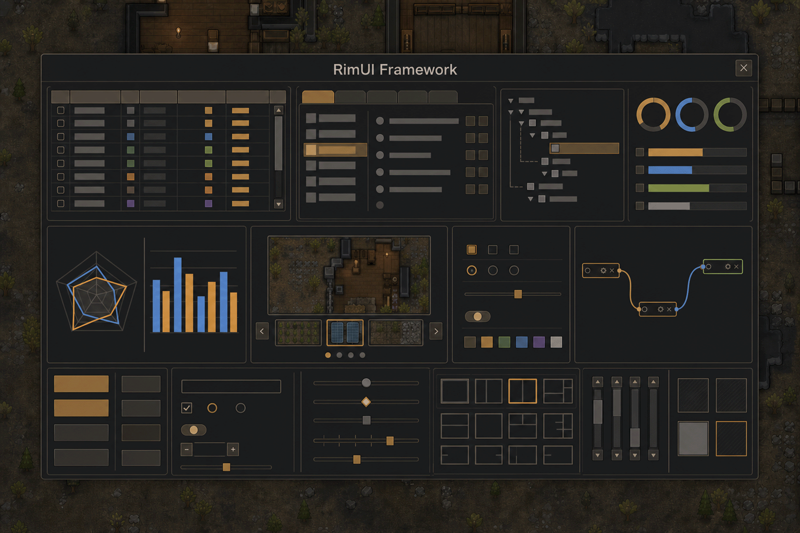

**RimUI Framework** — ядро `0.9.3` · мод `0.4.0` · RimWorld `1.6, 1.7`

---

[Оглавление](../index_ru.md) - Начало работы | Пред.: [Начало работы](01_start_ru.md) | След.: [Grid](../01-grid/01_grid_ru.md) | [English](02_versions_en.md)

---

# Версии игры

RimUI Framework работает в **RimWorld 1.6** и **RimWorld 1.7**. Возможности в обеих версиях одни и
те же: все компоненты, графики, связи `NodeCanvas`, анимации, курсоры, шрифты ОС и звук.

## Где лежит сборка

У каждой версии игры своя сборка фреймворка:

| Версия игры | Сборка |
|-------------|--------|
| RimWorld 1.6 | `1.6/Assemblies/RimUI.dll` |
| RimWorld 1.7 | `1.7/Assemblies/RimUI.dll` |

Игра сама загружает каталог своей версии. Темы, текстуры, переводы и документация лежат в корне мода
и общие для обеих версий. Каталога `Assemblies` в корне мода нет.

## Подключение в проекте

Референс на `RimUI.dll` берите из каталога той версии игры, под которую собираете свой мод.
Публичные типы и их члены в обеих сборках одинаковы: один и тот же код вашего мода компилируется
против любой из них.

## Чем версии отличаются

**Текст.** RimWorld 1.7 выводит и измеряет текст иначе, чем 1.6, поэтому ширина и высота одной и той
же надписи в версиях немного расходятся. Размеры элементов фреймворк считает сам по фактическому
тексту. Если же размер под текст задан у вас жёстко (`Width` или `Height` в пикселях), проверьте его
в обеих версиях.

---

[Оглавление](../index_ru.md) - Начало работы | Пред.: [Начало работы](01_start_ru.md) | След.: [Grid](../01-grid/01_grid_ru.md) | [English](02_versions_en.md)

## Поддержать автора
Если тебе нравится RimUI Framework, можешь поддержать разработку:

[DonationAlerts](https://www.donationalerts.com/r/klimprog)
[Boosty](https://boosty.to/klimprog/donate)

**USDT (TRC20):** `TA4zq9F4TTrSQXjEESMBk8juQMGNLXX4B5`

Спасибо! ❤️
